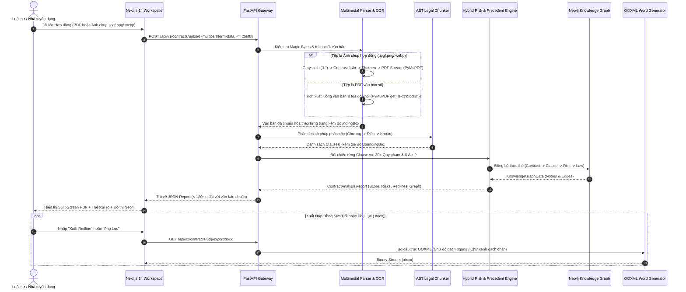

# Kiến Trúc Hệ Thống Chuyên Sâu (System Architecture & Engineering Spec)

Tài liệu này mô tả chi tiết thiết kế kiến trúc, luồng dữ liệu, mô hình đồ thị tri thức và các quyết định kỹ thuật (ADRs) của hệ thống **LegalAI Auditor**.

---

## 1. Sơ Đồ Tuần Tự Luồng Phân Tích Hợp Đồng (End-to-End Sequence Diagram)

---

## 2. Thiết Kế Các Phân Hệ Cốt Lõi (Core Subsystems)

### 2.1. Phân hệ Tiền xử lý Đa phương thức & Kiểm tra Chữ ký Tệp (`backend/app/engine/parser.py`)
- **Mục tiêu**: Xử lý cả tệp PDF xuất từ phần mềm soạn thảo lẫn ảnh chụp hợp đồng giấy bằng điện thoại trong điều kiện ánh sáng kém, đồng thời chặn tệp giả mạo định dạng.
- **Quy trình xử lý**:
  1. **Magic Bytes Validation (`validate_file_signature`)**: Kiểm tra byte đầu của tệp (`%PDF-`, `\x89PNG`, `\xff\xd8\xff`, `RIFF....WEBP`) nhằm chặn tuyệt đối các tệp HTML/Script/Executable đổi đuôi thành `.pdf` hoặc `.png`.
  2. Chuyển đổi không gian màu ảnh sang `L` (Grayscale) để loại bỏ nhiễu màu nền giấy vàng.
  3. Tăng cường độ tương phản (`ImageEnhance.Contrast(1.8)`) giúp tách biệt nét mực đen khỏi nền giấy.
  4. Áp dụng bộ lọc làm sắc nét (`ImageFilter.SHARPEN`) và chuyển đổi thành luồng PDF qua PyMuPDF (`fitz`).

### 2.2. Phân hệ Bóc tách Cú pháp Hợp đồng (`backend/app/engine/chunker.py`)
- **Mục tiêu**: Khắc phục hoàn toàn lỗi cắt ngang câu chữ của phương pháp chia chunk theo số lượng token cố định.
- **Thuật toán**:
  - Nhận diện tiêu đề điều khoản dựa trên mẫu biểu thức chính quy chuẩn hóa cho văn bản pháp lý Việt Nam: `^(?:ĐIỀU|Điều|ARTICLE|Article)\s+(\d+|[IVXLCDM]+)[\.:\s\-]+(.*)$`.
  - Tự động gộp các khoản (`1.1`, `1.2`, `a)`, `b)`) vào đúng `Điều` chủ quản.
  - Tính toán tọa độ tương đối `BoundingBox` trên trang tài liệu để phục vụ tính năng **Spotlight Focus Mode** và **Scroll-Sync** trên giao diện.

### 2.3. Phân hệ Thẩm định Rủi ro Lai (`backend/app/engine/risk_analyzer.py`)
- **Kiến trúc 2 lớp**:
  - **Lớp 1 (Deterministic Statutory Rule Matching & Boundary Evaluation)**: Kiểm tra chính xác các biên định lượng (trần thử việc `> 60 ngày` / `> 2 tháng`, trần phạt thương mại `> 8%` kể cả số thập phân `8,5%`, trần lãi suất chậm trả `> 20%/năm` hoặc `> 1.66%/tháng` hoặc `> 0.055%/ngày`), phân biệt ngữ cảnh hợp đồng lao động với hợp đồng thương mại để triệt tiêu báo lỗi giả (*False Positives*).
  - **Lớp 2 (Contextual Redline Synthesis)**: Sinh điều khoản thay thế (*Suggested Redline*) tuân thủ đúng mức trần pháp luật (ví dụ: tự động hạ mức phạt từ 15-20% xuống 8% theo Điều 301 Luật Thương mại 2005; hạ mức lãi chậm trả xuống $\le 20\%/\text{năm}$ theo Điều 468 Bộ luật Dân sự 2015).

### 2.4. Phân hệ Dự báo Tranh tụng & Án lệ (`backend/app/engine/precedent_engine.py`)
- Đối chiếu từng rủi ro phát hiện được với tập dữ liệu **Án lệ của Hội đồng Thẩm phán TANDTC** (Án lệ số `09/2017/AL`, `13/2017/AL`, `20/2018/AL`, `25/2018/AL`, `36/2020/AL`, `42/2021/AL`).
- Tính toán **Xác suất thua kiện (`loss_probability`)** khi đưa ra Tòa án Nhân dân hoặc Trọng tài Thương mại (VIAC) và ước tính án phí sơ thẩm theo **Nghị quyết 326/2016/UBTVQH14**.

---

## 3. Tiêu Chuẩn Kỹ Thuật Giao Diện (Frontend Engineering Standards)

Giao diện người dùng tại `frontend/src/` tuân thủ nghiêm ngặt các nguyên tắc kỹ thuật:
1. **Zero Layout Shift & Viewport Stability**: Sử dụng `h-[100dvh]` và bố cục Split-Screen cố định giúp người dùng đối chiếu song song tài liệu dài hàng chục trang mà không bị trôi thanh công cụ.
2. **GPU-Safe Rendering**: Hiệu ứng kính mờ (`backdrop-filter: blur`) chỉ được áp dụng cho các phần tử cố định (`Header`, `Floating Dock`, `Modal Backdrop`), tuyệt đối không gắn vào các thẻ cuộn lặp lại để duy trì tốc độ khung hình **60 FPS**.
3. **Resilient API Client (`frontend/src/lib/api.ts`)**: Mọi lời gọi mạng đều có cơ chế bắt lỗi và chuyển đổi mượt mà sang dữ liệu mẫu (`sampleData.ts`) khi chạy môi trường tĩnh.

---

## 4. Bảo Mật Ứng Dụng & Kiểm Thử Đối Kháng (Security & Adversarial Hardening)

Hệ thống được bảo vệ bởi các cơ chế kiểm soát an toàn ở cấp độ API và Engine (`tests/test_security_and_logic.py`):
1. **Read-Only Cypher Guard (`validate_readonly_cypher`)**: Chặn tuyệt đối các từ khóa biến đổi dữ liệu hoặc gọi thủ tục hệ thống (`DELETE`, `DETACH`, `CREATE`, `MERGE`, `SET`, `REMOVE`, `DROP`, `CALL`, `LOAD CSV`, `APOC`, `DBMS`) và giới hạn độ dài truy vấn $\le 2000$ ký tự.
2. **Magic Bytes & Payload Quota**: Kiểm tra chữ ký nhị phân thực tế của tệp tải lên và giới hạn dung lượng tối đa **25MB** (`HTTP 413`) trên mọi cổng tải tệp (`/upload`, `/compare`, `/upload-statute`), đồng thời ẩn chi tiết lỗi thư viện nội bộ khỏi phản hồi HTTP.
3. **Strict CORS Policy**: Chỉ cho phép danh sách Origin được cấu hình rõ ràng trong `ALLOWED_ORIGINS`, ngăn chặn tấn công Cross-Origin mang theo thông tin xác thực.

